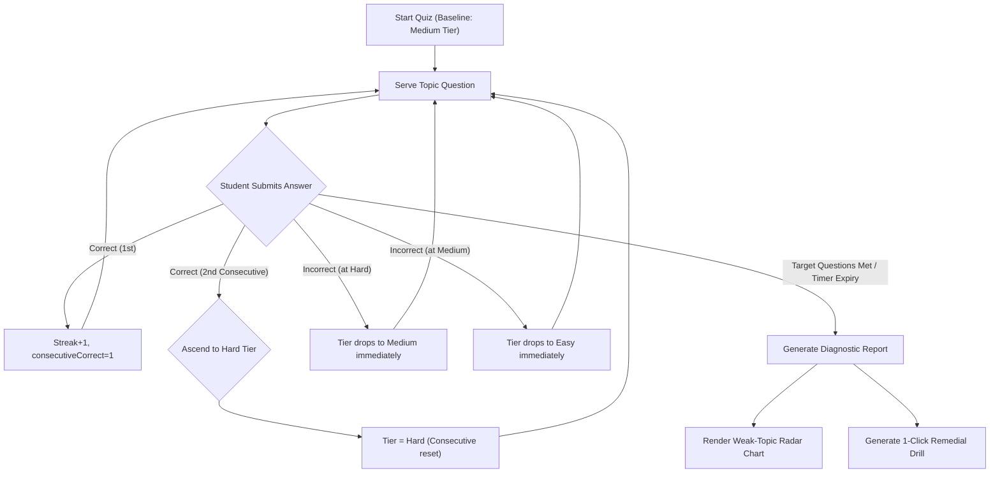

# QuizQuake: BrainStorm Arena 🧠⚡
### Computerized Adaptive Testing (CAT) & Weak-Topic Diagnostic Engine

> **Hackathon Problem Solution**: An intelligent, computerized adaptive quiz application that dynamically adjusts question difficulty based on live performance and delivers an interactive weak-topic diagnostic report upon quiz completion.

---

## 🌟 Executive Summary & Problem Context

Traditional multiple-choice testing systems present uniform question sequences irrespective of individual student capability, causing boredom for proficient students and overwhelming struggling peers. Furthermore, conventional score summaries merely return raw percentages without pinpointing specific conceptual deficiencies.

**QuizQuake: BrainStorm Arena** solves this by:
1. **Real-Time Difficulty Scaling:** Adjusting question tiers (`Easy` 🟢, `Medium` 🟡, `Hard` 🔴) dynamically based on consecutive responses.
2. **IRT Heuristic Approximation:** Calculating student ability $\theta \in [-3.0, +3.0]$ and cohort percentile benchmarks.
3. **Balanced Domain Coverage:** Round-robin topic scheduler across 64+ verified Computer Science problems (Data Structures, Algorithms, OS, Networks).
4. **Interactive Weak-Topic Radar Chart:** Chart.js radar visualization flagging critical knowledge deficiencies ($< 60\%$).
5. **Targeted Remedial Quiz Generator:** 1-Click instant generation of 5 focused drill questions addressing detected weak topics.
6. **One-Click Faculty PDF Scorecard:** Exportable diagnostic report with authorized review sign-off section.

---

## 🛠️ Tech Stack Architecture

- **Frontend:**
  - React 18 with TypeScript for strictly typed state management
  - Vite for ultra-fast HMR and bundle compilation
  - Tailwind CSS for modern, high-contrast engineering UI
  - Chart.js & React-Chartjs-2 for interactive Radar and Cohort Benchmark Bar visualizations
  - Lucide React for consistent icons
  - Canvas-Confetti for gamified milestone celebrations
- **Backend:**
  - Node.js with Express & TypeScript
  - Heuristic Adaptive IRT (Item Response Theory) Engine
  - Persistent JSON database store with SQLite schema compatibility for questions and historical attempt records
- **Question Repository:**
  - 64 verified Computer Science MCQs with deep technical rationale, code snippets, discrimination parameters ($a$), difficulty values ($b$), and subtopic classifications.

---

## 📐 Adaptive State Engine Logic



### Key Scaling Constraints:
- **Preventing Difficulty Oscillation:** Requires **two consecutive correct answers** to ascend to `Hard`, but descends down after a **single incorrect answer**.
- **Balanced Topic Queue:** Uses priority scheduling to evaluate unasked domains before repeating evaluated topics.
- **Session Recovery:** Synchronized countdown timer and submitted answers are stored in `sessionStorage` so refreshing the browser never loses an active test!

---

## 🚀 Quick Start Guide

### Option 1: One-Click Launch (Windows)
Double-click `run-project.bat` located in the root directory. It will:
1. Verify Node.js
2. Automatically install server and client dependencies
3. Launch the Backend API (`http://localhost:5000`)
4. Launch the Frontend UI (`http://localhost:3000`)
5. Open your default web browser to the test arena!

---

### Option 2: Manual Terminal Launch

#### Step 1: Start Backend Server
```bash
cd server
npm install
npm run dev
```
*Server starts at `http://localhost:5000`*

#### Step 2: Start Frontend Client
In a new terminal:
```bash
cd client
npm install
npm run dev
```
*Client starts at `http://localhost:3000`*

---

## 🎯 Verification & Demo Walkthrough

### What a Good Demo Looks Like (From Problem Brief):
1. **Launch Arena:** Enter candidate name, select all 4 topics, and start a 10-question quiz.
2. **Baseline Calibration:** First question arrives at **Medium** tier.
3. **Ascension Demonstration:**
   - Answer 2 Medium questions correctly in a row.
   - Watch the UI badge dynamically pulse and elevate to **Hard** tier with a complex challenge.
4. **Descent & Weak Topic Flagging:**
   - Answer a Hard Operating Systems / Deadlocks question incorrectly.
   - The tier immediately shifts back to Medium, and 'Deadlock Avoidance' is logged as a deficiency.
5. **Completion & Visual Diagnostic Report:**
   - On question 10 completion, confetti fires and the **Diagnostic Scorecard** is rendered.
   - **Weak-Topic Radar Chart** visualizes mastery percentages across evaluated domains.
   - **Cohort Percentile Benchmark** compares student accuracy against 1,240 simulated batch peers.
6. **Targeted Remedial Drill:**
   - Click **"Launch 1-Click Remedial Drill"** on the red deficiency banner.
   - Instantly test on 5 curated questions dedicated solely to the detected weak topics!
7. **One-Click PDF Report Export:**
   - Click **"Faculty PDF Scorecard"** and select **"Print / Save as PDF"** for academic review.
8. **Attempt History Logger:**
   - Click **"Attempt History"** in the top navigation to view historical accuracy trends and review past sessions.

---

## 📡 API Reference

| Endpoint | Method | Description |
| :--- | :--- | :--- |
| `/api/quiz/topics` | `GET` | Returns list of available engineering domains and counts |
| `/api/quiz/start` | `POST` | Initializes an adaptive testing session |
| `/api/quiz/active/:sessionId` | `GET` | Restores in-flight quiz session upon page refresh |
| `/api/quiz/next-question/:sessionId` | `GET` | Calibrates and returns next adaptive question |
| `/api/quiz/submit-answer` | `POST` | Evaluates answer, calculates score/streak, updates difficulty |
| `/api/quiz/finish` | `POST` | Finalizes quiz and compiles full diagnostic report |
| `/api/quiz/remedial` | `POST` | Generates 5-question remedial drill for weak topics |
| `/api/reports/attempts` | `GET` | Retrieves historical assessment logs |
| `/api/reports/attempts/:sessionId` | `GET` | Retrieves full diagnostic scorecard for a past attempt |
| `/api/reports/benchmarks` | `GET` | Retrieves cohort distribution benchmarks |

---

## ☁️ Cloud Hosting & Deployment Guide

QuizQuake is built for **unified single-port cloud deployment**: in production, the Express backend serves both the `/api/*` engine routes and the compiled React SPA static assets from `client/dist`, eliminating CORS and multi-server costs.

### 1. Render Deployment (1-Click Blueprint)
1. Push this repository to GitHub or GitLab.
2. In Render, select **New > Blueprint** and link your repository.
3. Render reads `render.yaml` and launches your unified service automatically:
   - **Build:** `npm run build`
   - **Start:** `npm start`
   - **Healthcheck:** `/api/health`

### 2. Docker / Cloud Run / Railway / Fly.io
Build and run the production multi-stage container locally or on any cloud container host:
```bash
# Build multi-stage image
docker build -t quizquake-arena .

# Run container
docker run -p 5000:5000 -e PORT=5000 quizquake-arena
```
The app will be available on `http://localhost:5000` with the healthcheck active at `http://localhost:5000/api/health`.

### 3. Vercel Deployment
The repository includes `vercel.json` configured for Vercel Static Builds and API routing.

---

## 🔌 Antigravity Plugin Installed: `quizquake-cloud`

The dedicated Antigravity plugin **QuizQuake Cloud Manager** has been authored and installed into your Antigravity environment at:
`~/.gemini/config/plugins/quizquake-cloud`

- **Plugin Name:** `quizquake-cloud`
- **Skill Provided:** `quizquake-deploy`
- **Rules Provided:** `rules/AGENTS.md` (Cloud port handling, health verification, asset bundling)
- **Status:** Installed and enabled via language server RPC. Manage it directly at: [quizquake-cloud](customization://quizquake-cloud).

---

## 👥 Authors
Developed for the **QuizQuake: BrainStorm Arena Hackathon Challenge**.
All source code and assets are self-contained in `c:\Users\charankumar\Desktop\fsd pro1`.
